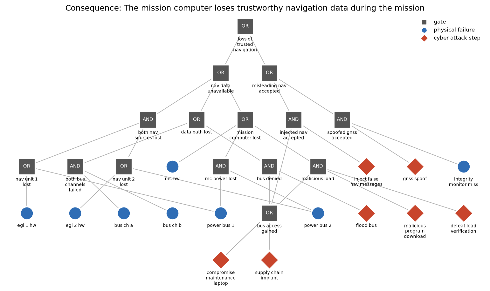

# One graph for failure and attack: unified RBDs and attack trees

[](https://github.com/GMCavalheri/cyber-physical-rbd-attack-trees/actions/workflows/ci.yml)

Reliability engineers model how a system fails by accident with **reliability block
diagrams**. Security analysts model how it fails under attack with **attack trees**. The two
models are maintained by different teams, in different tools, and rarely meet. This repository
puts both in **one graph** rooted at a system-level consequence, in the spirit of Idaho
National Laboratory's **Consequence-driven Cyber-Informed Engineering (CCE)**, and computes on
it exactly: the probability of the consequence, the easiest paths to it, and how physical and
cyber mitigations compare.

The core is `cpsrbd`, a small, typed Python package (NetworkX, NumPy, matplotlib), with proofs
that the unified model reduces **exactly** to the classical RBD when every event is physical
and to the classical attack tree when every event is cyber. A six-lesson course teaches it
from first principles.



## Headline results (synthetic case study)

The case study is a generic, defense-representative navigation chain. Its consequence is that
*the mission computer loses trustworthy navigation data during a 10 h mission*. The model has
15 gates, 8 physical failures and 7 effect-level cyber steps. All numbers are reproduced by
`validation/run_all.py`, and CI fails if any of them changes.

| question | answer | where |
|---|---|---|
| Probability of the consequence | **1.015e-3** per mission (exact, enumeration and Monte Carlo agree) | [propagation](validation/results/propagation.md) |
| What separate reliability and attack-tree analyses see, combined | **69 %** of it; the other **31 %** is the *interaction gap*, a GNSS spoof that the integrity check misses | [propagation](validation/results/propagation.md) |
| Cost of the tree formulas on shared dependencies | +0.1 % here, but **−88 %** on a bridge network (the common-cause trap) | [propagation](validation/results/propagation.md) |
| Easiest paths | a physical single point of failure (P 5.0e-4); the mixed spoof path (3.2e-4); the cheapest attack, **5 analyst-weeks** (laptop compromise + bus flooding) | [critical paths](validation/results/critical_path.md) |
| Engineering out one digital dependency | removing GNSS spoofing cuts risk most (−31 %); removing the maintenance laptop raises the cheapest attack from **5 to 42 weeks** | [critical paths](validation/results/critical_path.md) |
| Best mitigations | for risk, a redundant computer (−47 %) and a stronger integrity monitor; for attacker effort, the offline software loader. The two objectives pick **different portfolios at every budget above 100 units** | [mitigation](validation/results/mitigation.md) |
| How robust the ranking is | under lognormal input uncertainty the best value-for-money option is the laptop hardening in 53 % of draws; the ranking also moves with the assumed cyber likelihood scale | [mitigation](validation/results/mitigation.md) |
| Correctness | the reductions to the RBD (error 2e-16) and to the attack tree (exact) hold on 400 random models each; Shannon decomposition matches enumeration to 1e-15 | [reduction checks](validation/results/reduction_checks.md) |

The cyber likelihoods are explicit expert-judgement scores, not field data. The results are
meant for **comparison and structure** (which paths exist, which are mixed, which options
dominate), not as forecasts. See [methodology](docs/methodology.md) and [scope](docs/scope.md).

## What is in it

| module | does |
|---|---|
| [`unified_graph_model`](src/cpsrbd/unified_graph_model/) | the DAG of AND/OR/k-of-n gates over physical failures and cyber attack steps |
| [`rbd`](src/cpsrbd/rbd/) | series, parallel, k-out-of-n and path-set RBDs, closed forms, exact conversion |
| [`attack_tree`](src/cpsrbd/attack_tree.py) | classical attack trees, independently implemented, as the reference for the all-cyber reduction |
| [`consequence_driven_analysis`](src/cpsrbd/consequence_driven_analysis/) | consequence-first builder, likelihood scoring, the case study |
| [`probability_likelihood_propagation`](src/cpsrbd/probability_likelihood_propagation/) | exact (Shannon), enumeration, Monte Carlo, attribute domains, origin views and the interaction gap |
| [`critical_path_identification`](src/cpsrbd/critical_path_identification/) | minimal cut sets, most likely / cheapest / opportunistic paths, importance measures |
| [`mitigation_tradeoff_analysis`](src/cpsrbd/mitigation_tradeoff_analysis/) | redundancy (beta factor), controls, required steps, engineering-out; portfolios, Pareto fronts, sensitivity |
| [`plotting`](src/cpsrbd/plotting.py) | layered drawings of any model, scenarios highlighted |

## Quickstart

```bash
git clone https://github.com/GMCavalheri/cyber-physical-rbd-attack-trees
cd cyber-physical-rbd-attack-trees
uv sync
uv run pytest --cov
uv run python validation/run_all.py
```

```python
from cpsrbd.consequence_driven_analysis import navigation_case_study
from cpsrbd.critical_path_identification import cheapest_attacks, most_likely
from cpsrbd.probability_likelihood_propagation import exact_probability, origin_decomposition

model = navigation_case_study()
print(exact_probability(model))  # 1.015e-03
print(origin_decomposition(model).gap_share)  # 0.311: risk neither partial view contains
print(most_likely(model, 3)[1].label())  # gnss_spoof + integrity_monitor_miss
print(cheapest_attacks(model, 1)[0].attacker_cost)  # 5.0
```

## Documentation

* **Course:** [six lessons](docs/lessons/README.md), each with exercises and solutions, and an
  executed [notebook](notebooks/) per lesson.
* **Formal semantics:** [definitions, theorems and proofs](docs/formal-semantics.md):
  coherence, both reductions, exactness on DAGs, monotone design changes, the interaction gap.
* **Methodology:** [CCE phase by phase](docs/methodology.md), with the limits stated plainly.
* **Related work:** [an honest comparison](docs/related-work.md) with fault-tree/attack-tree
  combinations, attack-fault trees, BDMPs and STPA-Sec: what is not new, and what is.
* **Reference notes:** one per module ([unified model](docs/unified_graph_model.md),
  [RBD](docs/rbd.md), [consequence-driven analysis](docs/consequence_driven_analysis.md),
  [propagation](docs/probability_likelihood_propagation.md),
  [critical paths](docs/critical_path_identification.md),
  [mitigations](docs/mitigation_tradeoff_analysis.md)).
* **Scope:** [synthetic system, effect-level cyber steps, public sources only](docs/scope.md).

## Engineering

* 147 tests (pytest + Hypothesis), 99 % line coverage with a 90 % gate. Every test asserts
  against a closed form, an independent implementation, brute-force enumeration, or a cited
  textbook value. Property tests check every theorem of the formal semantics on random models.
* `ruff`, strict `mypy`, CI on Python 3.11–3.13, gitleaks and pip-audit, Dependabot.
* A `reproduce` CI job reruns every validation script and fails if any committed result
  changes, then executes every notebook.
* **Not included, on purpose:** this is a library and a course, not a deployed service, so
  there is no staging environment, observability stack or feature-flag service.

## Deviations from the plan

* The plan expected to reuse an RBD module from a separate avionics reliability project, which
  has not been built. Classical RBDs are implemented here (`cpsrbd.rbd`), so that project can
  depend on this one instead, and the plan's `external/` folder is not needed.
* The extension that reuses the CPS-01 synthetic system is deferred until CPS-01 exists. The
  ATT&CK for ICS extension is folded into the case study, at the effect level.
* Added beyond the plan, as groundwork for the methodology paper (RES-02): the formal
  semantics with proofs, the independent attack-tree reference, the interaction gap, and the
  related-work review.

## Licence

MIT. See [LICENSE](LICENSE).
