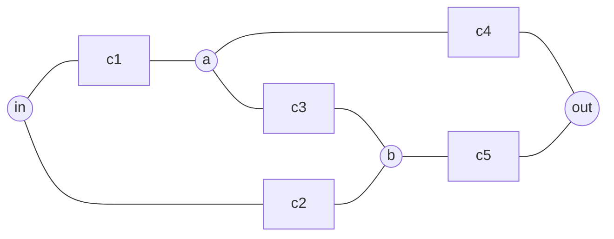

# Lesson 1 · Two languages for one failure

> A reliability engineer draws a **reliability block diagram**: boxes in series and in
> parallel, and the system works if a path of working boxes connects input to output. A
> security analyst draws an **attack tree**: a goal at the top, split into AND and OR sub-goals
> down to concrete attack steps. The two pictures look nothing alike, they are maintained by
> different teams, and they rarely meet. This lesson shows that underneath they are the same
> mathematical object, a monotone Boolean function of independent events, and builds the single
> data structure this project uses for both.

**Code:** [`src/cpsrbd/unified_graph_model/`](../../src/cpsrbd/unified_graph_model/),
[`src/cpsrbd/rbd/diagram.py`](../../src/cpsrbd/rbd/diagram.py) ·
**Tests:** [`tests/test_rbd.py`](../../tests/test_rbd.py),
[`tests/test_unified_graph_model.py`](../../tests/test_unified_graph_model.py) ·
**Next:** [Lesson 2](02-start-from-the-consequence.md)

## Learning objectives

1. Write the structure function of series, parallel, k-out-of-n and bridge structures, and
   compute their reliability.
2. Read an attack tree as a Boolean formula over attack steps.
3. Convert any RBD into failure logic with De Morgan's laws, and explain why the conversion is
   exact.
4. Explain why the unified model is a directed acyclic graph rather than a tree, and what a
   *shared* node costs us.
5. Use `UnifiedModel` to build a small mixed physical/cyber model and evaluate it.

---

## 1. Reliability block diagrams: success logic

Give each component $i$ a state variable $x_i \in \{0, 1\}$, where $x_i = 1$ means "works". An
RBD defines the **structure function** $\phi(\mathbf x)$, which is 1 when the system works.

| Structure | Works when | Structure function |
|---|---|---|
| Series of $n$ | every block works | $\phi = \prod_i x_i = \min_i x_i$ |
| Parallel of $n$ | at least one works | $\phi = 1 - \prod_i (1 - x_i) = \max_i x_i$ |
| $k$-out-of-$n$ | at least $k$ work | $\phi = \mathbb 1[\sum_i x_i \ge k]$ |

If the components are **independent** and $R_i = P(x_i = 1)$ is the reliability of component
$i$ over the mission, the expectation of $\phi$ is the system reliability, and for these three
structures it has a closed form:

```math
R_\text{series} = \prod_{i=1}^{n} R_i, \qquad
R_\text{parallel} = 1 - \prod_{i=1}^{n} (1 - R_i), \qquad
R_{k/n} = \sum_{j=k}^{n} \binom{n}{j} R^j (1 - R)^{n-j}.
```

The last formula is for identical blocks. With distinct blocks, $P(\text{at least } k)$ is a
Poisson-binomial tail, which [`at_least_k`](../../src/cpsrbd/rbd/diagram.py) computes with a
one-pass recursion: after processing each block, keep the distribution of the number that work.

Series and parallel nest: a series of parallel groups is still computed bottom-up, by
multiplying. That only works because each block appears **once**. If the same physical
component appears in two branches, the branches are no longer independent and the products are
wrong. [`reliability`](../../src/cpsrbd/rbd/diagram.py) refuses such a diagram rather than
returning a wrong number.

### The bridge: when series-parallel is not enough

Some structures are not series-parallel at all. The classic one is the **bridge**:



A **minimal path set** is a smallest set of components whose working guarantees the system
works. The bridge has four: $\{1,4\}$, $\{2,5\}$, $\{1,3,5\}$, $\{2,3,4\}$. The system works
when all components of at least one path set work. To get its reliability, **pivot** on the
cross-link $c_3$ (total probability):

```math
R = R_3 \bigl[1 - (1-R_1)(1-R_2)\bigr]\bigl[1 - (1-R_4)(1-R_5)\bigr]
  + (1 - R_3)\bigl[1 - (1 - R_1 R_4)(1 - R_2 R_5)\bigr].
```

If $c_3$ works, the middle nodes are joined and the structure is $(1 \parallel 2)$ in series
with $(4 \parallel 5)$. If $c_3$ fails, it is two series paths in parallel. With identical
components this collapses to $R = 2R^2 + 2R^3 - 5R^4 + 2R^5$, the textbook result that
`test_bridge_identical_components_polynomial` checks. Pivoting is a special case of **Shannon
decomposition**, the same tool Lesson 3 uses to deal with shared events in general.

## 2. Attack trees: goal logic

Schneier's attack trees (1999) put the attacker's goal at the root. Each node is either an
**OR** node (any child achieves it) or an **AND** node (all children are needed), and the
leaves are elementary attack steps. Mauw and Oostdijk (2005) gave them a formal semantics: an
attack tree denotes the set of **attack scenarios**, the minimal sets of leaves that achieve the
root.

In Boolean terms, let $y_j = 1$ when attack step $j$ succeeds. Then the root is a monotone
Boolean function of the $y_j$, built from $\wedge$ (AND) and $\vee$ (OR). Quantitative questions
come from decorating the leaves with **attributes** and combining them bottom-up:

| Attribute | Leaf value | OR combines with | AND combines with |
|---|---|---|---|
| success probability (independent steps) | $p_j$ | $1 - \prod (1 - p)$ | $\prod p$ |
| minimum attacker cost | $c_j$ | $\min$ | $\sum$ |
| is it possible at all? | true/false | $\vee$ | $\wedge$ |

The same table, read in failure logic, is a **fault tree**: the top event is a system failure,
OR and AND gates combine component failures. A fault tree and an attack tree differ in what the
leaves *mean*, not in their algebra.

## 3. De Morgan: from success logic to failure logic

Write $\bar x_i = 1 - x_i$ for "component $i$ failed" and $\bar\phi = 1 - \phi$ for "the system
failed". De Morgan's laws turn the success structures into failure structures:

```math
\overline{\textstyle\bigwedge_i x_i} = \textstyle\bigvee_i \bar x_i, \qquad
\overline{\textstyle\bigvee_i x_i} = \textstyle\bigwedge_i \bar x_i, \qquad
\overline{\left[\textstyle\sum_i x_i \ge k\right]} = \left[\textstyle\sum_i \bar x_i \ge n - k + 1\right].
```

In words:

* a **series** system fails if **any** block fails (OR of failures);
* a **parallel** system fails only if **all** blocks fail (AND of failures);
* a **k-out-of-n good** system fails when at least $n - k + 1$ blocks fail. A 2-out-of-3
  voting system fails when 2 of the 3 fail; a 1-out-of-4 parallel group fails when all 4 fail.
* a **path-set** structure fails when every path set contains a failed component:
  $\bar\phi = \bigwedge_{P} \bigvee_{i \in P} \bar x_i$.

These are identities of Boolean algebra, so the conversion is **exact**: there is no
approximation to validate, only a correspondence to check. `assert_dual` in
[`tests/test_rbd.py`](../../tests/test_rbd.py) checks it the brute-force way: for every one of
the $2^n$ states of the blocks, the converted model's top event happens if and only if the RBD
fails. Hypothesis runs it on 60 random nested RBDs per test run.

## 4. The unified model

Once both diagrams are in failure logic, nothing stops us from putting them in one graph. The
unified model is:

* a set of **basic events** (leaves), each tagged with its **origin**:
  * *physical*: a random component failure, with probability $p = 1 - e^{-\lambda t}$ from a
    constant failure rate $\lambda$ over an exposure time $t$;
  * *cyber*: an attack step, with an illustrative probability of success in the window and the
    attacker's cost to perform it;
* a set of **gates** (AND, OR, k-of-n) whose children are events or other gates;
* one **top event**: the consequence we care about.

```math
\text{TOP} = \Phi(z_1, \dots, z_m), \qquad z_j \in \{0, 1\},\ z_j = 1 \iff \text{event } j \text{ happens}.
```

$\Phi$ is built only from AND, OR and threshold gates, so it is **monotone**: making any event
happen can never stop the top event from happening. Reliability theory calls such systems
**coherent** (Barlow & Proschan, 1975), and monotonicity is what later makes the critical-path
and mitigation analyses well behaved.

### Why a DAG and not a tree

A tree gives every node exactly one parent. Real systems share things: both redundant sensor
channels draw from one power bus; one compromised maintenance laptop can reach two
controllers. In the graph that shared item is a node with **two parents**, so the structure is a
directed acyclic graph (DAG). `UnifiedModel.path_counts()` counts the root-to-node paths;
`shared_events()` lists the leaves reached by more than one path.

Sharing has a price. The bottom-up formulas of section 2 multiply probabilities of sibling
branches, which assumes the branches are independent. Two branches that contain the same leaf
are not. Lesson 3 shows how to get the exact answer anyway, and how wrong the naive answer can
be.

## 5. Code walkthrough

```python
from cpsrbd.unified_graph_model import UnifiedModel, cyber_step, physical_event

m = UnifiedModel("loss_of_function")
m.add_events(
    [
        physical_event("sensor_a", failure_rate=2e-5, exposure_time=1000.0),
        physical_event("sensor_b", failure_rate=2e-5, exposure_time=1000.0),
        physical_event("power", probability=1e-3),
        cyber_step("spoof_input", probability=0.01, cost=6.0, technique="T0856"),
    ]
)
m.and_("both_sensors_lost", "sensor_a", "sensor_b")
m.or_("loss_of_function", "both_sensors_lost", "power", "spoof_input")
m.validate()
print(m)  # ... 2 gates, physical events: 3, cyber steps: 1, shared events: 0
```

* [`nodes.py`](../../src/cpsrbd/unified_graph_model/nodes.py) defines `Gate` (with its
  `threshold()`: n for AND, 1 for OR, k for KOFN) and `BasicEvent` (probability, cost, origin,
  metadata). `physical_event` and `cyber_step` are the constructors you normally use.
* [`model.py`](../../src/cpsrbd/unified_graph_model/model.py) holds the graph as two
  dictionaries, gates and events, keyed by name. `validate()` checks that every child exists,
  k is in range, there are no cycles, and every node is reachable from the top event.
  `structure_function(failed)` evaluates $\Phi$ for one state; `graph()` exports a NetworkX
  `DiGraph` for drawing and graph algorithms.
* Editing methods (`with_event`, `with_gate`, `pruned`) return **copies**. Mitigation analysis
  (Lesson 5) compares a model with many modified versions of itself, so it must never mutate
  the baseline.
* [`rbd/diagram.py`](../../src/cpsrbd/rbd/diagram.py): `to_unified(rbd)` walks the RBD and emits
  OR for series, AND for parallel, KOFN with threshold $n - k + 1$ for k-of-n, and the
  AND-of-ORs for path sets. A block name that appears twice becomes **one** shared event, which
  is exactly the case the closed forms could not handle.

## 6. Where this leaves us

We have one language: a coherent Boolean function of independent, tagged events, stored as a
DAG. What is still missing is the *meaning* of the numbers on cyber leaves (Lesson 2 and
`docs/scope.md`), a way to compute the top-event probability exactly on a DAG (Lesson 3), and
the questions engineers actually ask: which combination is the cheapest way to the consequence
(Lesson 4), and where to spend money (Lesson 5).

---

## Exercises

1. A pump train has two pumps in parallel, in series with one valve. $R_\text{pump} = 0.9$,
   $R_\text{valve} = 0.99$. Compute $R$, then write the failure-logic gate structure.
2. Show that a 2-out-of-3 good system with identical blocks has $R = 3R^2 - 2R^3$, and that it
   is better than a single block exactly when $R > 1/2$.
3. Convert a 3-out-of-5 good structure to failure logic. What is the threshold of the KOFN gate?
4. Use the bridge pivot formula with all $R_i = 0.9$. Compare with a plain "two series paths in
   parallel" structure (no $c_3$). How much does the cross-link buy?
5. An attack tree's root is OR(AND(a, b), c) with independent success probabilities 0.5, 0.4 and
   0.1, and costs 2, 3 and 10. Compute the success probability and the minimum attack cost.
6. Why does `reliability()` reject `Parallel(Series(a, b), Series(a, c))`? What is the correct
   reliability, by pivoting on $a$?

### Solutions

1. Parallel pumps: $1 - 0.1^2 = 0.99$. Series with the valve: $0.99 \times 0.99 = 0.9801$.
   Failure logic: OR(valve failed, AND(pump 1 failed, pump 2 failed)).
2. $P(\text{exactly } 2) + P(3) = 3R^2(1-R) + R^3 = 3R^2 - 2R^3$. Then
   $3R^2 - 2R^3 - R = -R(2R - 1)(R - 1)$, which is positive for $1/2 < R < 1$.
3. $n - k + 1 = 5 - 3 + 1 = 3$: the system fails when at least 3 of the 5 fail.
4. Pivot: $0.9 \times 0.99 \times 0.99 + 0.1 \times (1 - 0.19^2) = 0.88209 + 0.09639 = 0.97848$.
   Without $c_3$: $1 - (1 - 0.81)^2 = 0.9639$. The cross-link improves reliability by about
   0.0146, which cuts the failure probability from 0.0361 to 0.0215, a 40 % reduction.
5. $P(\text{AND}) = 0.2$; $P = 1 - (1 - 0.2)(1 - 0.1) = 0.28$. Cost: $\min(2 + 3, 10) = 5$.
6. Component $a$ appears in both branches, so they are dependent. Pivot on $a$: if $a$ works,
   $R = 1 - (1 - R_b)(1 - R_c)$; if it fails, $R = 0$. So
   $R = R_a\bigl[1 - (1 - R_b)(1 - R_c)\bigr]$, not the naive
   $1 - (1 - R_a R_b)(1 - R_a R_c)$, which double-counts $a$'s chance of working.

## References

* M. Rausand and A. Høyland, *System Reliability Theory: Models, Statistical Methods, and
  Applications*, 2nd ed., Wiley, 2004, ch. 4 (structure functions, k-out-of-n, the bridge).
* R. E. Barlow and F. Proschan, *Statistical Theory of Reliability and Life Testing:
  Probability Models*, Holt, Rinehart and Winston, 1975 (coherent systems).
* W. E. Vesely, F. F. Goldberg, N. H. Roberts and D. F. Haasl, *Fault Tree Handbook*,
  NUREG-0492, U.S. Nuclear Regulatory Commission, 1981.
* B. Schneier, "Attack trees", *Dr. Dobb's Journal*, 24(12), 1999.
* S. Mauw and M. Oostdijk, "Foundations of attack trees", *Information Security and
  Cryptology – ICISC 2005*, LNCS 3935, Springer, 2006, pp. 186–198.
