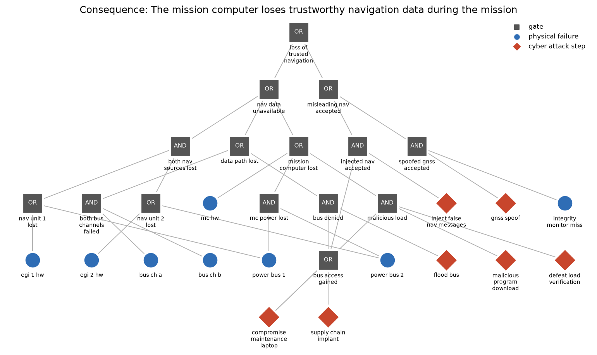

# Lesson 2 · Start from the consequence

> Most security assessments start from the network: list the assets, scan for vulnerabilities,
> score them, patch the worst. Consequence-driven Cyber-Informed Engineering (CCE), developed
> at Idaho National Laboratory, turns this around. It starts from the outcome the organisation
> cannot tolerate and works backward to every way, physical or digital, that the outcome could
> happen. Reliability engineers already think this way: a fault tree starts from an undesired
> top event. This lesson builds the project's case study in that order and puts honest numbers
> on its leaves.

**Code:** [`src/cpsrbd/consequence_driven_analysis/`](../../src/cpsrbd/consequence_driven_analysis/) ·
**Data:** [`case_study_parameters.csv`](../../src/cpsrbd/data/case_study_parameters.csv) ·
**Results:** [`validation/results/case_study.md`](../../validation/results/case_study.md) ·
**Scope rules:** [`docs/scope.md`](../scope.md) ·
**Previous:** [Lesson 1](01-two-languages-for-one-failure.md) · **Next:** [Lesson 3](03-propagating-probability-and-likelihood.md)

## Learning objectives

1. Describe the four phases of CCE and where a unified failure/attack model fits in them.
2. State a consequence precisely enough to build a model from it.
3. Develop a model top-down, so that no branch is left half-analysed.
4. Turn expert scores for an attack step into a probability, and say what that number does
   and does not mean.
5. Classify every branch of a model as physical-only, cyber-only or mixed, and explain why the
   mixed ones matter most.

---

## 1. CCE in four phases

INL's CCE methodology rests on one premise: a capable, targeted adversary *will* get into the
networks, so the question is not whether, but what they could then make the physical process
do. Its four phases are:

| Phase | Question | In this project |
|---|---|---|
| 1 · Consequence prioritization | Which high-consequence events (HCEs) must never happen? | the top event, stated in words |
| 2 · System-of-systems analysis | What does the function behind each HCE depend on? | the gates: functions, redundancy, shared dependencies |
| 3 · Consequence-based targeting | What would an adversary have to do, step by step, to cause it? | cyber leaves and their AND/OR structure; critical paths (Lesson 4) |
| 4 · Mitigations and protections | How do we remove or block those paths? | mitigation trade-offs (Lesson 5) |

Phase 4 prefers engineering changes that remove the digital path to the physical effect
altogether (a hard-wired interlock, a manual step, an isolated function) over controls that
only make the path harder. Lesson 4 calls this **engineering out** a dependency and measures
it.

CCE is usually run as workshops with engineers and analysts, and its output is qualitative.
This project asks what happens if the same structure is written down as a model that can be
computed: the HCE becomes a top event, the system-of-systems analysis becomes gates, and the
targeting becomes cyber leaves sitting next to the physical failures the reliability team
already models.

## 2. State the consequence

A good consequence statement names a **function**, says how it is **lost**, and fixes a
**window**:

> *The mission computer loses trustworthy navigation data during the mission* (10 h).

"Trustworthy" matters. A navigation function can be lost in two ways:

* **availability**: no data arrives (both sources dead, the data bus down, the computer down);
* **integrity**: false data arrives and is accepted (a spoofed GNSS solution that the
  integrity cross-check misses, or falsified messages injected on the bus).

Reliability analyses usually model only the first. Attackers are often more interested in the
second, because a system that confidently uses wrong data can be worse than one that knows it
has none. Writing the consequence this way forces both into the model.

## 3. Develop it top-down

[`ConsequenceBuilder`](../../src/cpsrbd/consequence_driven_analysis/builder.py) writes the model
in the order an analyst thinks:

```python
from cpsrbd.consequence_driven_analysis import CONSEQUENCE, ConsequenceBuilder

b = ConsequenceBuilder(CONSEQUENCE)
b.any_of(CONSEQUENCE.name, "nav_data_unavailable", "misleading_nav_accepted")
b.any_of("nav_data_unavailable", "both_nav_sources_lost", "data_path_lost", "mission_computer_lost")
b.all_of("both_nav_sources_lost", "nav_unit_1_lost", "nav_unit_2_lost")
...
```

Two rules make it a discipline rather than a drawing tool:

* a node can only be developed after something refers to it as a cause (top-down order);
* `build()` refuses to finish while any referenced cause is still undeveloped, and lists them.

The full case study is in
[`case_study.py`](../../src/cpsrbd/consequence_driven_analysis/case_study.py):



Read it from the top:

* **Navigation sources**: two embedded GNSS/INS units in 1-out-of-2 redundancy (an AND gate in
  failure logic). Each unit is lost if its hardware fails or its power bus fails.
* **Data path**: a dual-channel bus. It fails physically only if both channels fail, but an
  adversary who has code running on any bus-connected device can flood both channels at once.
  Redundancy against random failure is not redundancy against a deliberate common cause.
* **Mission computer**: fails if its hardware fails, if both power buses fail (it is fed from
  both), or if a modified software load disables it. That load needs the maintenance laptop
  to be compromised, the load transferred, and the load verification defeated.
* **Integrity**: a GNSS spoof only matters if the integrity cross-check misses it (a mixed
  cyber AND physical branch). Falsified bus messages need bus access first.

### Shared dependencies

Four basic events are reached by more than one path
([results](../../validation/results/case_study.md)):

| shared event | paths to the top |
|---|---|
| `compromise_maintenance_laptop` | 3 |
| `power_bus_1`, `power_bus_2` | 2 each |
| `supply_chain_implant` | 2 |

The power buses are the classic reliability case: one physical failure removes a navigation
unit *and* half of the computer's supply. The laptop is the cyber equivalent: one foothold
serves three different attack goals. In an attack tree drawn as a strict tree, the analyst
would copy the laptop node three times and then, when computing probabilities, treat the
copies as independent, which overstates how many separate things must go wrong. Keeping one
shared node is what makes the numbers in Lesson 3 exact.

## 4. Numbers on the leaves

### Physical failures

Each physical event has a constant failure rate $\lambda$ and the window $t$ = 10 h, so

```math
p = 1 - e^{-\lambda t} \approx \lambda t \quad (\lambda t \ll 1).
```

A navigation unit with an assumed MTBF of 5000 h ($\lambda$ = 2e-4 per hour) has
$p \approx$ 2.0e-3 per mission. All rates are round assumptions, labelled as such in the CSV.

### Cyber steps: an honest likelihood scale

There is no field database of "probability that this adversary compromises this maintenance
laptop during one mission". What exists is expert judgement, which risk assessment practice
usually expresses on ordinal scales. The project makes that judgement explicit with two scores:

* **capability required**, from 1 (commodity tools and skills) to 5 (nation-state resources);
* **opportunity**, from 1 (no realistic access path) to 5 (routinely exposed).

The combined score $s$ = opportunity + (6 − capability) runs from 2 to 10, and is mapped
log-linearly onto a probability band, by default from 1e-4 to 1e-1
([`scoring.py`](../../src/cpsrbd/consequence_driven_analysis/scoring.py)):

```math
\log_{10} p(s) = \log_{10} p_{\text{low}} + \left(\log_{10} p_{\text{high}} - \log_{10} p_{\text{low}}\right)\frac{s - 2}{8}.
```

| $s$ | 2 | 3 | 4 | 5 | 6 | 7 | 8 | 9 | 10 |
|---|---|---|---|---|---|---|---|---|---|
| $p$ | 1.0e-4 | 2.4e-4 | 5.6e-4 | 1.3e-3 | 3.2e-3 | 7.5e-3 | 1.8e-2 | 4.2e-2 | 1.0e-1 |

Why log-linear? Each step on the ordinal scale multiplies the likelihood by the same factor
(here $10^{3/8} \approx 2.4$). That matches how people use such scales ("one band more likely")
much better than equal additive steps would.

What the number means: the chance that the step succeeds within the window **given a capable,
motivated adversary is working on this system**. It is a conditional, judgement-based
quantity. Two consequences follow, and the rest of the course respects them:

1. Use cyber probabilities for **comparison** (which path, which mitigation), not as a forecast
   of how often the consequence will happen.
2. Treat the band and the scores as **parameters to vary**. Lesson 5 does exactly that.

Each step also has an **attacker cost** in analyst-weeks, which Lesson 4 uses to find the
cheapest way to the consequence, and an ATT&CK for ICS technique ID that names the effect
(for example T0814, Denial of Service, for flooding the bus). The GNSS spoof has no ID: it acts
in the radio-frequency domain, which ATT&CK for ICS does not cover, and the table says so
rather than forcing a match.

## 5. Which branches are mixed?

[`branch_kinds`](../../src/cpsrbd/consequence_driven_analysis/builder.py) labels each gate by
the origins of the leaves below it. In the case study: 5 gates are physical-only, 4 cyber-only
and 6 mixed.

The physical-only branches are what a reliability team already analyses. The cyber-only
branches are what a security team already analyses. The **mixed** gates are where neither team
looks on its own: `spoofed_gnss_accepted` needs an attack *and* a random detection miss;
`data_path_lost` can come from two cable failures *or* one flooding node. That is the
connective tissue this project is about.

[`paths_to(model, node)`](../../src/cpsrbd/consequence_driven_analysis/builder.py) prints the
backward walk from the consequence to any leaf. For the maintenance laptop it returns three
paths, one per goal it serves.

---

## Exercises

1. Write a consequence statement for a water-pumping station that covers both availability and
   integrity. Which leaf in your model would be shared?
2. A step has capability 4 and opportunity 4. Compute its score and probability with the
   default band, and with the band [1e-5, 1e-1].
3. Why is `bus_denied` an AND of `bus_access_gained` and `flood_bus`, while
   `both_bus_channels_failed` is an AND of the two channels? What does each AND protect
   against?
4. The integrity cross-check misses a spoof with probability 0.1. If the spoof itself has
   probability 3.2e-3, what is the probability of `spoofed_gnss_accepted`? (They are
   independent.)
5. Suppose the laptop node were copied three times instead of shared. Name one analysis whose
   answer would change, and say in which direction.

### Solutions

1. For example: *"The station delivers no water, or delivers water outside its quality limits
   while the operators believe it is within them, during one day."* A shared leaf might be the
   engineering workstation that can reprogram both the pump controller and the quality
   analyser.
2. $s = 4 + (6 - 4) = 6$, so $p = 10^{-4 + 3 \cdot 4/8} = 10^{-2.5} \approx$ 3.2e-3. With
   [1e-5, 1e-1]: $\log_{10} p = -5 + 4 \cdot 4/8 = -3$, $p$ = 1e-3.
3. The channel AND is redundancy against independent random failures. The bus-denial AND is
   the attack sequence: the adversary needs a foothold before they can flood. The physical AND
   gives no protection against the cyber branch, because one flooding node defeats both
   channels.
4. $3.2 \times 10^{-3} \times 0.1 = 3.2 \times 10^{-4}$.
5. The top-event probability: with copies treated as independent, the AND gates that need the
   laptop (`malicious_load`, and the bus-access branches) and the OR that combines them would
   count the laptop's chance several times over. Lesson 3 measures the error. The minimal
   attacker cost is also overstated whenever two goals that share the laptop are combined by
   AND, since the attacker pays for the laptop once.

## References

* Idaho National Laboratory, *Consequence-driven Cyber-informed Engineering (CCE)*,
  <https://inl.gov/national-security/cce/>, and the *CCE Phase 1–4 Reference Document*, 2023.
* A. A. Bochman and S. Freeman, *Countering Cyber Sabotage: Introducing Consequence-Driven,
  Cyber-Informed Engineering (CCE)*, CRC Press, 2021.
* U.S. Department of Energy, *National Cyber-Informed Engineering Strategy*, June 2022.
* MITRE, *ATT&CK for ICS*, <https://attack.mitre.org/techniques/ics/> (accessed 2026-11-14).
* W. E. Vesely et al., *Fault Tree Handbook*, NUREG-0492, U.S. NRC, 1981 (top-down
  development of a top event).
