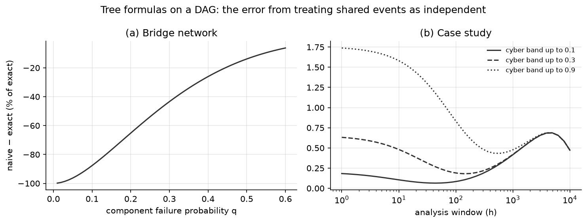
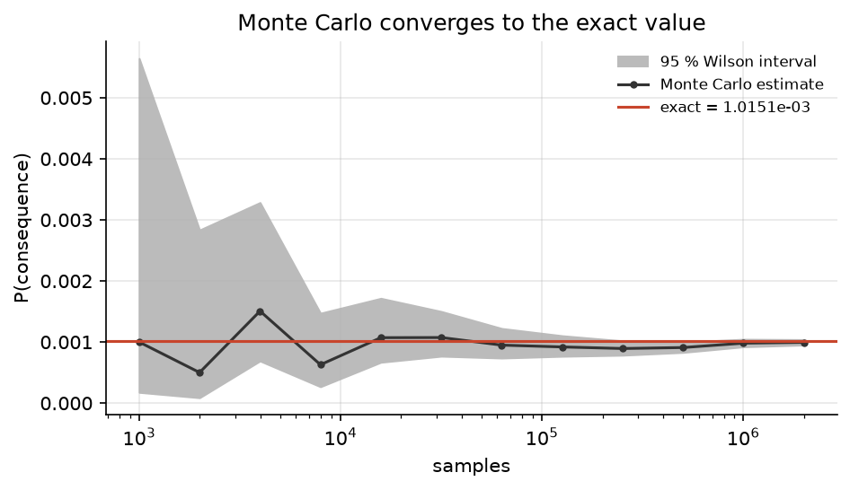
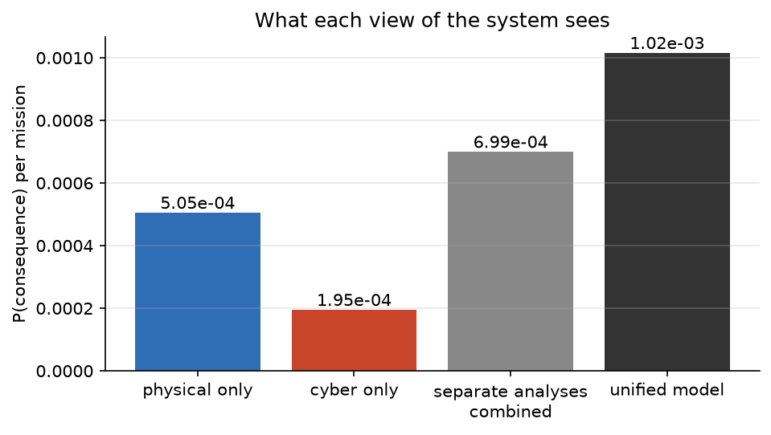

# Lesson 3 · Propagating probability and likelihood through one graph

> With the model built, the first quantitative question is the obvious one: how likely is the
> consequence? On a tree the answer is a few multiplications. On the graphs real systems
> produce, where one power bus or one compromised laptop feeds several branches, the same
> multiplications can be wrong by almost 100 %. This lesson derives the propagation rules,
> shows exactly when and why they fail, fixes them with Shannon decomposition, checks the fix
> three independent ways, and then reads what the case study says.

**Code:** [`probability_likelihood_propagation/probability.py`](../../src/cpsrbd/probability_likelihood_propagation/probability.py),
[`probability_likelihood_propagation/domains.py`](../../src/cpsrbd/probability_likelihood_propagation/domains.py) ·
**Tests:** [`tests/test_propagation.py`](../../tests/test_propagation.py) ·
**Results:** [`validation/results/propagation.md`](../../validation/results/propagation.md) ·
**Previous:** [Lesson 2](02-start-from-the-consequence.md) · **Next:** [Lesson 4](04-the-lowest-effort-path.md)

## Learning objectives

1. Derive the AND, OR and k-of-n propagation formulas from independence.
2. Predict the sign of the error those formulas make when two branches share an event.
3. Compute the exact top-event probability on any DAG with Shannon decomposition, and prove it
   is exact.
4. Validate an exact method with enumeration and Monte Carlo, and size a Monte Carlo run.
5. Use attribute domains (cost, most likely scenario) and know their limits on DAGs.
6. Read the case-study numbers: what a reliability-only or security-only analysis would miss.

---

## 1. Bottom-up propagation on a tree

Let the children $C_1, \dots, C_n$ of a gate be **independent** events with probabilities
$q_1, \dots, q_n$. Then

```math
P(\text{AND}) = \prod_{i} q_i, \qquad
P(\text{OR}) = 1 - \prod_{i} (1 - q_i), \qquad
P(k\text{-of-}n) = \sum_{|S| \ge k}\ \prod_{i \in S} q_i \prod_{i \notin S} (1 - q_i).
```

The OR formula is "one minus the probability that none happens". The k-of-n sum has $2^n$
terms, but the Poisson-binomial recursion of Lesson 1 computes it in $O(n^2)$.

In a **tree**, the subtrees under the children of any gate contain disjoint sets of basic
events, so the children are independent and these formulas, applied from the leaves up, are
exact. `bottom_up_probability` does exactly this.

## 2. What goes wrong on a DAG

Take the smallest DAG that matters:

```math
\text{TOP} = (a \vee c) \wedge (b \vee c), \qquad P(a) = 0.3,\ P(b) = 0.4,\ P(c) = 0.2.
```

The two OR gates share $c$. The tree formulas give
$(1 - 0.7 \cdot 0.8)(1 - 0.6 \cdot 0.8) = 0.44 \times 0.52 = 0.2288$. The truth, by conditioning
on $c$: if $c$ happens, both ORs happen; if not, we need $a$ and $b$:

```math
P(\text{TOP}) = P(c) + \bigl(1 - P(c)\bigr) P(a) P(b) = 0.2 + 0.8 \times 0.12 = 0.296.
```

The tree formulas **under**estimate by 23 %. The two branches are positively correlated (they
both happen whenever $c$ does), and an AND of positively correlated events is more likely than
the product of their probabilities. The mirror case, an OR of positively correlated branches,
is **over**estimated by the tree formula, because $P(A \cup B) = P(A) + P(B) - P(A \cap B)$
and the overlap $P(A \cap B)$ is larger than $P(A)P(B)$. So:

| shared event sits under ... | tree formula |
|---|---|
| an AND (redundancy) | underestimates: redundancy looks better than it is |
| an OR (alternatives) | overestimates, usually slightly when probabilities are small |

The first row is the dangerous one, and it is the classic **common-cause** trap in reliability
engineering: two "redundant" channels fed by one power bus are not two independent chances to
survive. The [results](../../validation/results/propagation.md) show the extreme case, the
bridge network (every component is in two path sets, combined by AND):

| bridge, every component fails with q = 0.1 | P(system failure) |
|---|---|
| exact | 0.02152 |
| tree formulas | 0.002651 (−88 %) |



In the case study, the shared events (power buses, the maintenance laptop, the supply-chain
implant) sit mostly under ORs, and the tree formulas are off by only +0.10 %. The right panel
shows the error stays below 2 % even when the cyber band is pushed up to 0.9. That is a
property of this model, not a licence: the method has to be exact in general.

## 3. Shannon decomposition: exact on any DAG

For any basic event $x$, the law of total probability gives Shannon's expansion

```math
P(\text{TOP}) = p_x \, P(\text{TOP} \mid x = 1) + (1 - p_x) \, P(\text{TOP} \mid x = 0).
```

Conditioning sets $x$ to a constant, which removes it as a source of dependence.
`exact_probability` does this for every **shared** basic event (reached by two or more paths
from the top), enumerating the $2^s$ joint states of the $s$ shared events and running the
tree formulas once per state, weighted by the state's probability.

**Why that is enough.** Fix all shared basic events. Take any gate $G$ and two of its children
$A$ and $B$. Suppose a *free* (unfixed) basic event $e$ were below both. Then $e$ would be
reachable from the top through $A$ and through $B$, so by at least two paths: it would be
shared, hence fixed. Contradiction. So the free events below different children are disjoint,
the children are independent given the fixed values, and the tree formulas are exact at every
gate. (A shared *gate* only has shared events below it, so after conditioning it is a
constant, 0 or 1.) Summing over the $2^s$ conditional results with their weights gives the
exact $P(\text{TOP})$. ∎

The case study has $s = 4$ shared events: 16 bottom-up passes. The cost grows as $2^s$, which
is fine for models of tens of shared events and not for thousands. Industrial fault-tree tools
handle that scale with binary decision diagrams (BDDs, Rauzy 1993), which apply the same
expansion recursively and share identical sub-results. The semantics are identical; only the
bookkeeping differs.

## 4. Trust, but verify: three independent checks

**Enumeration.** `enumerate_probability` evaluates the Boolean structure function on all $2^n$
states of all $n$ basic events and adds up the probabilities of the failed states. It shares no
code with the propagation formulas, so agreement is meaningful. For the case study
($n$ = 15, 32 768 states) it agrees with the exact method to $6.7 \times 10^{-17}$, and
Hypothesis checks the agreement on 80 random DAGs per test run.

**Closed forms.** The plan's first validation requirement is that an all-physical model must
reduce *exactly* to classical RBD results. Every structure in the first results table (series,
parallel, 2-out-of-3, 3-out-of-5, two bridges) matches $1 - R$ to within $1.2 \times 10^{-16}$,
and a Hypothesis test repeats this on 60 random nested RBDs.

**Monte Carlo.** `monte_carlo_probability` samples all basic events, evaluates the gates on
whole arrays, and reports the fraction of samples where the top event happens with a **Wilson
score interval**:

```math
\tilde p = \frac{\hat p + \frac{z^2}{2n}}{1 + \frac{z^2}{n}}, \qquad
\text{half-width} = \frac{z}{1 + \frac{z^2}{n}} \sqrt{\frac{\hat p(1 - \hat p)}{n} + \frac{z^2}{4n^2}}.
```

The usual $\hat p \pm z\sqrt{\hat p(1-\hat p)/n}$ interval behaves badly for rare events (it
collapses to zero width when no hits are seen); Wilson's does not. With 2 000 000 samples the
estimate is 9.945e-4, with 95 % interval [9.518e-4, 1.039e-3], which contains the exact
1.015e-3.



For a rare event the relative half-width is about $z/\sqrt{np}$. To get ±5 % at $p = 10^{-3}$
you need $n \approx (1.96 / 0.05)^2 / 10^{-3} \approx 1.5 \times 10^6$ samples. This is why exact
methods matter: Monte Carlo is a check, not the main tool, for small probabilities.

## 5. Other attributes: domains

Probability is one attribute. Attack-tree practice uses others, and Mauw and Oostdijk (2005)
showed they share one structure: a leaf value plus an operator for OR and one for AND.
[`domains.py`](../../src/cpsrbd/probability_likelihood_propagation/domains.py) implements four:

| domain | leaf | OR | AND | question it answers |
|---|---|---|---|---|
| `PROBABILITY` | $p$ | $1 - \prod(1-p)$ | $\prod p$ | how likely is the goal? |
| `MIN_COST` | attacker cost (∞ for physical) | min | sum | cheapest way for an attacker |
| `MOST_LIKELY` | $p$ | max | product | probability of the single most likely scenario |
| `POSSIBLE` | cost < ∞ | any | all | can the attacker do it alone? |

Physical failures get cost ∞: the attacker cannot buy a random hardware failure. On the case
study, `MIN_COST` at the top is 5 analyst-weeks, and `POSSIBLE` is true: there is a purely
cyber path. A k-of-n gate takes the $k$ cheapest (or most likely) children.

The same DAG caveat applies. If an AND gate's children share the laptop, bottom-up `MIN_COST`
charges the attacker for the laptop twice. The exact answer is the minimum over **minimal cut
sets**, which is where Lesson 4 starts.

## 6. What the case study says

From [`propagation.md`](../../validation/results/propagation.md):

| view | P(consequence) per mission | share of the full model |
|---|---|---|
| physical failures only (classical reliability) | 5.05e-4 | 50 % |
| cyber steps only (classical attack tree) | 1.95e-4 | 19 % |
| both analysed separately, then combined | 6.99e-4 | 69 % |
| unified model | 1.015e-3 | 100 % |



Each team's model sees part of the risk, as expected. The striking line is the third: even if
both teams do their work and someone combines the results, 31 % of the risk is still missing.
It is the mixed branch `spoofed_gnss_accepted` (3.16e-4): a GNSS spoof (cyber) that the
integrity cross-check misses (a random detection failure, 0.1). The reliability model has no
spoof to feed it, and the attack tree assumes the cross-check works, so neither contains it.

Two cautions, from Lesson 2. First, the cyber numbers are judgement-based scores, so the
absolute value 1.015e-3 is not a forecast. Second, the qualitative finding (a mixed branch
that neither partial view contains carries a third of the risk) holds whatever the exact
scores are, because it comes from the **structure** of the model. Lesson 5 checks how robust
the ranking of risks and mitigations is when the scores move.

---

## Exercises

1. Compute exact and naive probabilities for $\text{TOP} = (a \wedge c) \vee (b \wedge c)$
   with $P(a) = 0.3$, $P(b) = 0.4$, $P(c) = 0.2$. Which way is the naive answer wrong, and why?
2. A model has 6 shared events. How many bottom-up passes does `exact_probability` make? What
   if two of them are always fixed by an override to 0 or 1?
3. Show that for $p \ll 1$, the OR formula is approximately $\sum_i q_i$ (the rare-event
   approximation), and give the next correction term.
4. How many Monte Carlo samples are needed for a ±10 % (95 %) estimate of the case study's
   `malicious_load` branch, which has probability 1.33e-8? What does that tell you?
5. Why does `POSSIBLE` return false for AND(physical failure, cyber step), even though the
   probability of that AND can be large?

### Solutions

1. Exact: $P(c)\bigl[1 - (1 - 0.3)(1 - 0.4)\bigr] = 0.2 \times 0.58 = 0.116$. Naive:
   $1 - (1 - 0.06)(1 - 0.08) = 0.1352$, an overestimate (+17 %): an OR of two branches that are
   positively correlated through $c$.
2. $2^6 = 64$. Overrides to 0 or 1 make the zero-weight states drop out (the code skips them),
   leaving $2^4 = 16$ passes that contribute.
3. $1 - \prod(1 - q_i) = \sum_i q_i - \sum_{i<j} q_i q_j + \dots$ (inclusion-exclusion), so the
   first correction is $-\sum_{i<j} q_i q_j$, second order in the small probabilities.
4. $n \approx (1.96/0.1)^2 / 1.33 \times 10^{-8} \approx 2.9 \times 10^{10}$ samples. Rare
   branches are out of reach for plain Monte Carlo; exact methods (or importance sampling)
   are needed.
5. `POSSIBLE` asks whether the attacker can achieve the goal **on their own**. The AND needs a
   random physical failure the attacker cannot cause, so the answer is no, however likely the
   coincidence. This is why Lesson 4 treats such paths separately: they are *opportunistic*
   (wait for, or coincide with, a failure) rather than attacker-controlled.

## References

* C. E. Shannon, "The synthesis of two-terminal switching circuits", *Bell System Technical
  Journal*, 28(1), 1949, pp. 59–98 (the expansion theorem).
* A. Rauzy, "New algorithms for fault trees analysis", *Reliability Engineering & System
  Safety*, 40(3), 1993, pp. 203–211 (binary decision diagrams for fault trees).
* E. B. Wilson, "Probable inference, the law of succession, and statistical inference",
  *Journal of the American Statistical Association*, 22(158), 1927, pp. 209–212.
* L. D. Brown, T. T. Cai and A. DasGupta, "Interval estimation for a binomial proportion",
  *Statistical Science*, 16(2), 2001, pp. 101–133.
* S. Mauw and M. Oostdijk, "Foundations of attack trees", *ICISC 2005*, LNCS 3935, Springer,
  2006, pp. 186–198.
* M. Rausand and A. Høyland, *System Reliability Theory*, 2nd ed., Wiley, 2004, ch. 6 (fault
  tree quantification, common-cause failures).
