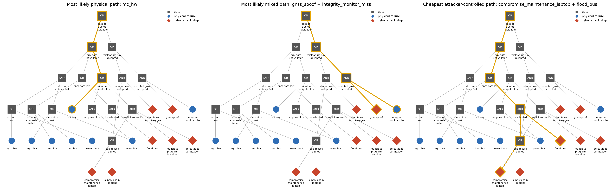
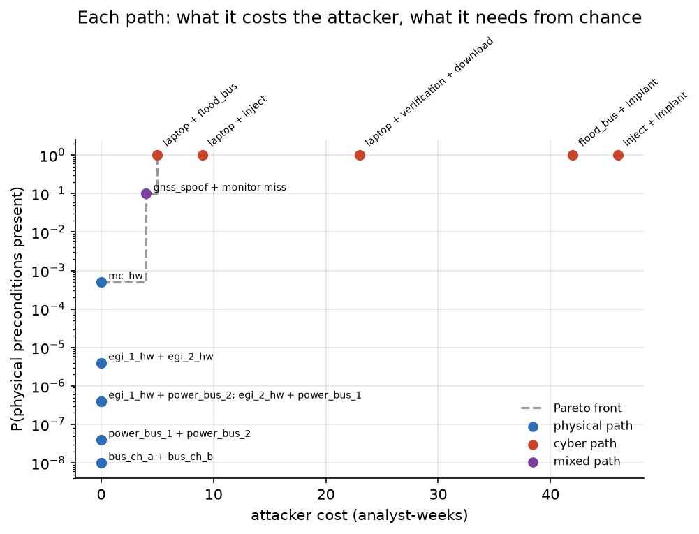
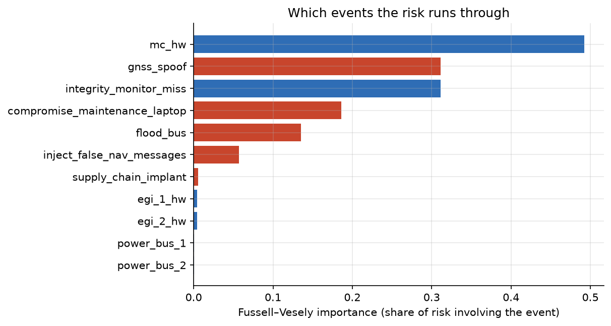

# Lesson 4 · The lowest-effort path and digital engineering-out

> A probability for the consequence is a summary. Engineers and defenders need the
> *scenarios*: which combinations of failures and attack steps lead there, which is the easiest,
> and which single item, if removed, would cut the most risk. Reliability engineering calls
> these minimal cut sets and importance measures; attack-tree analysis calls them attack
> scenarios and the cheapest attack. In the unified model they are the same objects, and this
> lesson computes them for the case study. It ends with a result that matters for CCE: the
> mitigation that removes the most *probability* is not the one that costs the attacker the
> most *effort*.

**Code:** [`critical_path_identification/cut_sets.py`](../../src/cpsrbd/critical_path_identification/cut_sets.py),
[`critical_path_identification/importance.py`](../../src/cpsrbd/critical_path_identification/importance.py) ·
**Tests:** [`tests/test_critical_path.py`](../../tests/test_critical_path.py) ·
**Results:** [`validation/results/critical_path.md`](../../validation/results/critical_path.md) ·
**Previous:** [Lesson 3](03-propagating-probability-and-likelihood.md) · **Next:** [Lesson 5](05-comparing-mitigations.md)

## Learning objectives

1. Define a minimal cut set and compute all of them by Boolean expansion.
2. Classify every path to the consequence as physical, cyber or mixed.
3. Define "lowest effort" in three ways (likelihood, attacker cost, opportunistic trade-off)
   and say which question each answers.
4. Compute and interpret Birnbaum, criticality, Fussell–Vesely, RAW and RRW importance.
5. Use RRW to rank candidate "engineer-out" changes, and explain why the ranking depends on
   the metric.

---

## 1. Minimal cut sets

A **cut set** is a set of basic events whose joint occurrence causes the top event. It is
**minimal** if removing any one event stops it from being a cut set. For a coherent (monotone)
model, the top event is exactly

```math
\text{TOP} = \bigvee_{C \in \mathcal C} \ \bigwedge_{e \in C} e,
```

the OR over minimal cut sets of the AND of their events. This is the model's **disjunctive
normal form**, and it is unique. In fault trees each $C$ is a minimal failure scenario. In
Mauw and Oostdijk's semantics of attack trees each $C$ is an attack scenario (their "bundle"
of leaves). Same definition, different words.

**Computing them.** [`minimal_cut_sets`](../../src/cpsrbd/critical_path_identification/cut_sets.py)
works from the leaves up. Each node gets a *family* of sets:

* a basic event $e$: $\{\{e\}\}$;
* OR: the union of the children's families;
* AND: every union $A_1 \cup \dots \cup A_n$ with one $A_i$ from each child's family;
* k-of-n: the OR, over every choice of $k$ children, of the AND of those children;

and after each step it removes duplicates and every set that contains another set
(**absorption**: $c \vee (c \wedge a) = c$). On the small DAG of Lesson 3,
$(a \vee c) \wedge (b \vee c)$, the AND produces $\{a,b\}, \{a,c\}, \{c,b\}, \{c\}$, and
absorption leaves $\{c\}$ and $\{a, b\}$. The classical top-down algorithm, MOCUS (Fussell and
Vesely, 1972), produces the same family. The bottom-up version memoises each node once, which
suits DAGs.

Two tests pin this down. The bridge gives its four textbook cut sets
$\{1,2\}, \{4,5\}, \{1,3,5\}, \{2,3,4\}$. On random DAGs, Hypothesis checks that "some cut
set has fully happened" equals the structure function for every state, and that dropping any
event from any cut set breaks it (minimality).

## 2. The case study's twelve paths

| rank | minimal cut set | kind | P | attacker cost |
|---|---|---|---|---|
| 1 | `mc_hw` | physical | 5.0e-4 | — |
| 2 | `gnss_spoof` + `integrity_monitor_miss` | mixed | 3.2e-4 | 4 |
| 3 | `compromise_maintenance_laptop` + `flood_bus` | cyber | 1.3e-4 | 5 |
| 4 | laptop + `inject_false_nav_messages` | cyber | 5.6e-5 | 9 |
| 5 | `flood_bus` + `supply_chain_implant` | cyber | 4.2e-6 | 42 |
| 6 | `egi_1_hw` + `egi_2_hw` | physical | 4.0e-6 | — |
| … | (six more, all below 2e-6) | | | |

The full table is in [`critical_path.md`](../../validation/results/critical_path.md). Grouped
by kind: 6 physical cut sets carry 50 % of the risk, 5 cyber ones 19 %, and the single mixed
one 31 %.

Three things stand out:

* **The mission computer is a single point of failure.** A one-event cut set is always worth a
  second look: no redundancy stands between it and the consequence. Lesson 5 prices fixing it.
* **Redundancy works against chance**: the two navigation units appear only together (rank 6,
  4e-6), and the dual bus channels only together (rank 12, 1e-8).
* **Redundancy does not work against an adversary on the bus**: rank 3 defeats both bus
  channels at once with two cyber steps. The physical AND gate is still in the model; the
  attacker simply goes around it.

**Rare-event check.** Summing the cut-set probabilities gives 1.0165e-3, against the exact
1.0151e-3. The sum is an upper bound (it double-counts overlaps), and with small probabilities
it is tight. That is why practitioners often quantify fault trees from cut sets alone.



## 3. Three meanings of "lowest effort"

The plan asks for "the lowest-effort path (physical, cyber, or combined)". Effort means
different things for different paths, so the code offers three rankings.

**Most likely (unified).** Rank cut sets by probability, or equivalently by the effort
$-\ln P(C) = \sum_{e \in C} -\ln p_e$. This metric *adds* along an AND, like cost, so it is a
true "shortest path" length, and it treats physical and cyber events alike. Winner:
`mc_hw` (effort 7.6), then the mixed spoof path (8.1).

**Cheapest attack.** Restrict to cut sets the attacker can complete alone (no physical
events) and rank by summed attacker cost. Winner: laptop + flood, 5 analyst-weeks. This is the
classical attack-tree minimum-cost attribute, computed **exactly**: the minimum over cut sets
pays for a shared step once, while the bottom-up min-cost domain of Lesson 3 can pay twice.
`test_shared_step_is_paid_once` builds a model where bottom-up says 22 and the truth is 12. In
the case study both give 5.

**Opportunistic trade-off.** A mixed path costs the attacker something *and* needs a physical
condition that they cannot cause: the GNSS spoof costs 4 weeks but only succeeds when the
integrity cross-check misses it (probability 0.1). Each cut set is a point
(attacker cost, probability that its physical preconditions are present), and
[`opportunistic_front`](../../src/cpsrbd/critical_path_identification/cut_sets.py) keeps the
Pareto-optimal ones: no other path is both cheaper and less dependent on chance.



The front has three points: the free but improbable hardware failure, the cheap but
chance-dependent spoof, and the more expensive but certain bus attack. Every other path is
dominated. An adversary choosing a path, or a defender guessing which one they would choose,
should look at this front, not at a single number.

## 4. Importance measures

Cut sets show the scenarios; importance measures rank the **events**. Let $Q = P(\text{TOP})$,
and let $Q(1_i)$, $Q(0_i)$ be the top-event probability with event $i$ forced to happen or made
impossible:

| measure | definition | reads as |
|---|---|---|
| Birnbaum | $I_B(i) = Q(1_i) - Q(0_i) = \partial Q / \partial q_i$ | sensitivity of the top event to $q_i$ |
| criticality | $I_{CR}(i) = I_B(i) q_i / Q$ | P($i$ happened and was critical, given the top event) |
| Fussell–Vesely | $I_{FV}(i) = P(D_i)/Q$, $D_i$ = some cut set containing $i$ happened | share of the risk that involves $i$ |
| RAW | $Q(1_i)/Q$ | how much worse if $i$ is certain |
| RRW | $Q/Q(0_i)$ | how much better if $i$ is impossible |

The Birnbaum identity $Q(1_i) - Q(0_i) = \partial Q/\partial q_i$ holds because $Q$ is linear
in each $q_i$ (Shannon's expansion again: $Q = q_i Q(1_i) + (1-q_i) Q(0_i)$).
`test_birnbaum_is_the_derivative` checks it with finite differences.



In the case study:

* `mc_hw` tops every list: FV 0.49, RAW 985 (if the computer has failed, the consequence is
  certain).
* `gnss_spoof` and `integrity_monitor_miss` have the same FV, 0.31, because they appear only
  together, in one cut set. Their RAW values are very different: 99 for the spoof (if
  spoofing is guaranteed, the risk is a 10 % detection miss) and 3.8 for the monitor (a
  guaranteed miss still needs a spoof, which is rare). **FV says where risk flows; RAW says
  what to protect against becoming certain.** For a cyber step, RAW is the question "what if
  the adversary already has this capability?"
* `compromise_maintenance_laptop` has FV 0.19 and RAW 26. It sits on three paths at once
  (Lesson 2), which is why it matters more than its own probability suggests.

## 5. Engineering out a digital dependency

CCE's Phase 4 prefers changes that **remove** a digital path to a physical effect rather than
just guarding it. In the model, engineering out a cyber step means making it impossible:
$q_i \to 0$ and cost $\to \infty$. The top-event probability afterwards is exactly $Q(0_i)$,
the quantity behind RRW, and the cheapest remaining attack is a new minimum over cut sets:

| cyber step engineered out | P(TOP) after | risk reduction | cheapest attack after |
|---|---|---|---|
| `gnss_spoof` | 6.99e-4 | 31 % | 5 weeks |
| `compromise_maintenance_laptop` | 8.27e-4 | 19 % | **42 weeks** |
| `flood_bus` | 8.79e-4 | 13 % | 9 weeks |
| `inject_false_nav_messages` | 9.58e-4 | 6 % | 5 weeks |
| `supply_chain_implant` | 1.009e-3 | 0.6 % | 5 weeks |

The two columns disagree. Removing GNSS dependence (for example, a navigation mode that does
not trust GNSS when it disagrees with inertial data beyond a bound) cuts the most
*probability*, but a determined attacker still has the 5-week bus attack. Removing the laptop's
reach (software loads from a dedicated, offline loader, no shared maintenance laptop) cuts less
probability but multiplies the attacker's cheapest effort by more than 8, because every cheap
attack went through that one foothold.

Which matters more depends on the threat model. Against random failures and opportunists,
probability rules. Against a targeted adversary, the premise of CCE, the minimum attacker
effort is the better guide, and the laptop is the better target. The unified model shows
both at once; that is the point of having one model.

---

## Exercises

1. Find the minimal cut sets of $\text{AND}(\text{OR}(a, b), \text{OR}(a, c), d)$.
2. A 2-out-of-4 failure gate (fails when 2 of 4 fail) has how many minimal cut sets? A
   3-out-of-4?
3. For $\text{OR}(a, b)$ with $q_a = 0.1$, $q_b = 0.2$, compute all five importance measures
   for $a$.
4. Why must the rare-event sum over cut sets always be at least the exact probability?
5. After engineering out the laptop, the cheapest attack costs 42 weeks. Which one is it, and
   which single additional engineer-out would push the minimum to 46 or more?

### Solutions

1. Expand: $\text{OR}(a,b) \wedge \text{OR}(a,c) = a \vee (b \wedge c)$; with $d$:
   $\{a, d\}$ and $\{b, c, d\}$.
2. Every 2-subset of 4 events, $\binom{4}{2} = 6$; every 3-subset, $\binom{4}{3} = 4$.
3. $Q = 0.28$. $I_B = 1 - q_b = 0.8$; $I_{CR} = 0.8 \times 0.1 / 0.28 = 0.286$;
   $I_{FV} = q_a / Q = 0.357$; RAW $= 1/0.28 = 3.57$; RRW $= 0.28/0.2 = 1.4$.
4. $P(\bigcup_C A_C) \le \sum_C P(A_C)$ (Boole's inequality), where $A_C$ is "every event of
   $C$ happened". Equality would need the $A_C$ to be disjoint, which they never are here.
5. `flood_bus` + `supply_chain_implant` (2 + 40). Engineering out `flood_bus` too leaves
   `inject_false_nav_messages` + `supply_chain_implant` at 46 weeks; engineering out
   `supply_chain_implant` instead leaves no pure-cyber path at all (infinite cost), so the
   attacker would need a physical failure to coincide.

## References

* J. B. Fussell and W. E. Vesely, "A new methodology for obtaining cut sets for fault trees",
  *Transactions of the American Nuclear Society*, 15, 1972, pp. 262–263 (MOCUS).
* Z. W. Birnbaum, "On the importance of different components in a multicomponent system",
  in P. R. Krishnaiah (ed.), *Multivariate Analysis II*, Academic Press, 1969, pp. 581–592.
* W. E. Vesely, T. C. Davis, R. S. Denning and N. Saltos, *Measures of Risk Importance and
  Their Applications*, NUREG/CR-3385, U.S. NRC, 1983 (risk achievement and reduction worth).
* M. Rausand and A. Høyland, *System Reliability Theory*, 2nd ed., Wiley, 2004, ch. 5
  (importance measures).
* S. Mauw and M. Oostdijk, "Foundations of attack trees", *ICISC 2005*, LNCS 3935, Springer,
  2006, pp. 186–198.
* A. A. Bochman and S. Freeman, *Countering Cyber Sabotage: Introducing Consequence-Driven,
  Cyber-Informed Engineering (CCE)*, CRC Press, 2021.
