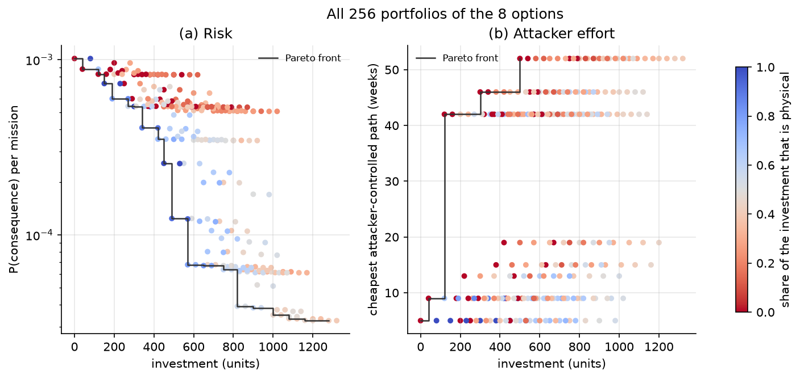
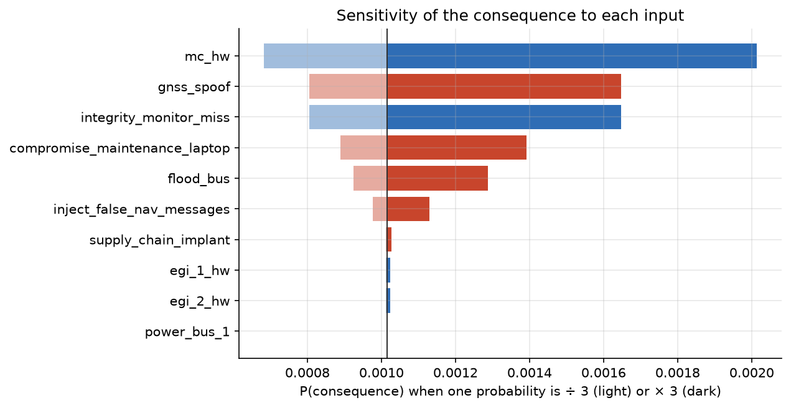
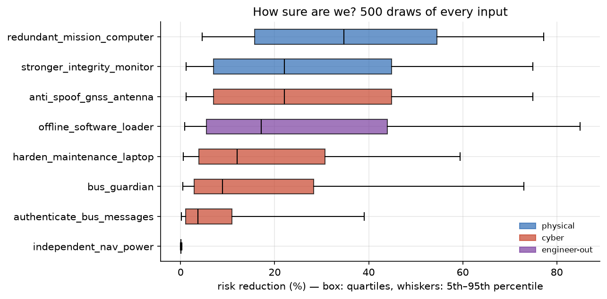

# Lesson 5 · Comparing physical and cyber mitigations in one currency

> A reliability engineer proposes a second mission computer. A security engineer proposes
> authenticating the bus messages. Both cost money, both "reduce risk", and in most
> organisations they are judged by different committees with different spreadsheets. On one
> model they can be compared directly, singly and in every combination, on two yardsticks:
> how much they reduce the probability of the consequence, and how much they raise the
> attacker's cheapest effort. This lesson does that, then asks the question every honest
> analysis must ask: how much of the answer survives when the inputs are uncertain?

**Code:** [`mitigation_tradeoff_analysis/`](../../src/cpsrbd/mitigation_tradeoff_analysis/) ·
**Tests:** [`tests/test_mitigation.py`](../../tests/test_mitigation.py) ·
**Results:** [`validation/results/mitigation.md`](../../validation/results/mitigation.md) ·
**Previous:** [Lesson 4](04-the-lowest-effort-path.md) · **Next:** [Lesson 6](06-formal-semantics-and-what-is-new.md)

## Learning objectives

1. Express a mitigation as a transformation of the model, for four kinds of change.
2. Derive the beta-factor model and explain why it caps the value of redundancy.
3. Evaluate every portfolio of options and read a Pareto front.
4. Explain why the best portfolio for risk and the best for attacker effort differ.
5. Run one-at-a-time and probabilistic sensitivity analysis, and report what is robust.

---

## 1. A mitigation is a model transformation

[`mitigations.py`](../../src/cpsrbd/mitigation_tradeoff_analysis/mitigations.py) defines four
kinds, each a function from a model to a modified **copy**:

| kind | change to the graph | typical example |
|---|---|---|
| `AddRedundancy` | physical event $e$ becomes "both units fail" (with common cause) | second computer, backup power |
| `ReduceProbability` | $q_e \to f q_e$; attacker cost $c_e \to c_e + \Delta c$ | better detection, hardening |
| `RequireStep` | target $t$ becomes $t \wedge s$ for a new cyber step $s$ | message authentication, bus guardian, segmentation |
| `EngineerOut` | $q_e \to 0$, $c_e \to \infty$ | remove the digital dependency (CCE Phase 4) |

Because they are all transformations of one model, every mitigation is evaluated by the same
exact propagation (Lesson 3) and the same exact minimum attacker cost (Lesson 4). Physical and
cyber options become directly comparable. That is the whole method.

The tests check the properties every mitigation must have: redundancy never increases the
risk; a cyber control never lowers the attacker's cheapest cost or raises the risk;
engineering a step out removes every cut set that contains it. Hypothesis runs each property
on random models.

## 2. Redundancy with common cause: the beta factor

Duplicating a component with failure probability $q$ does not give $q^2$ in practice: some
causes (a shared design flaw, an installation error, a power transient, a bad software load)
hit both units at once. The **beta-factor model** (Fleming, 1975), used for example in
IEC 61508-6, splits each unit's failures into an independent part $(1 - \beta)q$ and a common
part $\beta q$ that fails both:

```math
Q_{\text{pair}} = 1 - \bigl(1 - (1-\beta)^2 q^2\bigr)\bigl(1 - \beta q\bigr) \approx \beta q + (1-\beta)^2 q^2.
```

For the mission computer, $q$ = 5.0e-4 and $\beta$ = 0.05 give
$Q_{\text{pair}} \approx 2.5 \times 10^{-5} + 2.3 \times 10^{-7}$: the common-cause term is
**100 times** the independent one. Redundancy improves this component 20-fold, not 2000-fold, and
the limit is set by $\beta$, not by $q$. `AddRedundancy` builds exactly this structure:
OR(AND(unit a, unit b), ccf). With $\beta = 1$ it buys nothing, and a test checks that.

The cyber view adds a harsher point, which Lesson 4 already showed for the bus: an adversary
acts as a common cause with $\beta = 1$. Two computers loaded from the same compromised laptop
fail together. CPS-04 in this portfolio studies that problem in depth.

## 3. Each option alone

The case study's [catalogue](../../src/cpsrbd/mitigation_tradeoff_analysis/catalogue.py) has 8
options with illustrative investments (assumptions, like everything else):

| option | category | investment | risk reduction | per 100 units | cheapest attack after |
|---|---|---|---|---|---|
| harden_maintenance_laptop | cyber | 40 | 13 % | 0.32 | 9 weeks |
| stronger_integrity_monitor | physical | 150 | 28 % | 0.19 | 5 |
| redundant_mission_computer | physical | 300 | 47 % | 0.16 | 5 |
| offline_software_loader | engineer-out | 120 | 19 % | 0.15 | **42** |
| anti_spoof_gnss_antenna | cyber | 250 | 28 % | 0.11 | 5 |
| bus_guardian | cyber | 180 | 13 % | 0.07 | 9 |
| authenticate_bus_messages | cyber | 200 | 6 % | 0.03 | 5 |
| independent_nav_power | physical | 80 | 0.07 % | 0.001 | 5 |

Three observations:

* The **stronger integrity monitor** (a physical/design change) and the **anti-spoof antenna**
  (a cyber control) give exactly the same risk reduction, because they act on the two events
  of the same cut set (spoof AND miss) by the same factor. The monitor is cheaper. A
  security-only analysis would never have proposed it, since the monitor is not a security
  control.
* **Backup power** is almost worthless here: the power buses appear only in cut sets that
  already need a second failure (Lesson 4). Importance measures predicted this.
* Only **engineering out** the laptop moves the attacker's cheapest path from 5 to 42 weeks.

## 4. Portfolios and two Pareto fronts

With 8 options there are $2^8 = 256$ portfolios. [`portfolios`](../../src/cpsrbd/mitigation_tradeoff_analysis/analysis.py)
evaluates all of them exactly, and `pareto_front` keeps the ones that no other portfolio beats
on both investment and the chosen yardstick.



Read the left panel (risk): the front starts with cheap cyber hygiene (laptop hardening),
then the integrity monitor, then the redundant computer, and mixes them. At 570 units the
front's portfolio (redundant computer, stronger monitor, offline loader) has cut the risk from
1.0e-3 to 6.8e-5, a factor of 15. The colour shows the physical share of the spend: between
150 and 900 units, the risk-optimal portfolios put 55–100 % of it into physical options.

The right panel (attacker effort) tells a different story. Its front is entirely cyber and
engineer-out: offline loader (42 weeks at 120 units), then add the bus guardian (46), then
message authentication (52). No physical option raises the attacker's cheapest cost, because
none of them touches the cyber-only cut sets.

| budget | best for risk | P(TOP) | attack cost | best for attacker effort | P(TOP) | attack cost |
|---|---|---|---|---|---|---|
| 200 | monitor + laptop hardening | 6.0e-4 | 9 | backup power + offline loader | 8.3e-4 | 42 |
| 300 | redundant computer | 5.4e-4 | 5 | bus guardian + offline loader | 8.2e-4 | 46 |
| 500 | computer + monitor + hardening | 1.2e-4 | 9 | authentication + guardian + loader | 8.2e-4 | 52 |

At every budget above 100, the two objectives choose **different** portfolios. This is not a
modelling artefact. It is the trade-off CCE asks decision makers to face explicitly: spend
against random failure and opportunistic attack (probability), or against a determined,
targeted adversary (effort). The unified model does not choose for you; it shows the price of
each choice in the same units. (At the 200 budget the effort-optimal choice includes backup
power only to use up the budget: it is a tie on attacker cost, broken by risk.)

## 5. Sensitivity: what survives uncertain inputs?

**One at a time (tornado).** Divide and multiply each input probability by 3 and recompute:



The swing ranking is the importance ranking of Lesson 4, as it should be: the computer, then
the spoof and the monitor miss (identical, same cut set), then the laptop and bus flooding. A
factor of 3 on any single cyber score moves the consequence by at most a factor of about 1.6.

**All at once (probabilistic).** [`uncertainty_samples`](../../src/cpsrbd/mitigation_tradeoff_analysis/analysis.py)
redraws every probability from a lognormal around its nominal value, with **error factor**
EF = 95th percentile / median, the convention of probabilistic risk assessment
($\sigma = \ln \mathrm{EF} / 1.645$). Physical failures get EF = 3 and cyber steps EF = 10,
an order of magnitude either way, which is honest for judgement-based scores. Every option is
evaluated on the **same** 500 draws (common random numbers), so differences between options are
not blurred by sampling noise.



* The baseline P(TOP) has a 90 % interval of [5.1e-4, 8.8e-3]: more than a factor of 17. The
  absolute risk is **not** known to better than an order of magnitude, as Lesson 2 warned.
* The **ordering** of options by median reduction is much more stable than the absolute
  values, and backup power stays useless in every draw.
* The best option per unit invested is laptop hardening in 53 % of draws, the stronger
  monitor in 31 % and the redundant computer in 16 %. A single "best mitigation" is not a
  robust claim; a shortlist of three is.

**Changing the scale itself.** Shifting the whole cyber likelihood band changes the answer:

| cyber band | P(TOP) | best per unit invested |
|---|---|---|
| 1e-5 to 1e-2 | 5.4e-4 | redundant mission computer |
| 1e-4 to 1e-1 (default) | 1.0e-3 | laptop hardening |
| 1e-3 to 0.3 | 6.1e-3 | laptop hardening, then offline loader |

If cyber steps are rare, physical redundancy is the best buy. If they are common, cyber
measures dominate. This is the most important lesson of the phase. The decision depends on
the threat assumption, and the unified model makes that dependence **visible and testable**
instead of leaving it hidden in two separate reports.

---

## Exercises

1. Show that for small $q$ the beta-factor pair has $Q \approx \beta q + (1-\beta)^2 q^2$, and
   find the $\beta$ at which the two terms are equal for $q$ = 5e-4.
2. Why do `stronger_integrity_monitor` and `anti_spoof_gnss_antenna` give identical risk
   reductions? Would they still if the antenna also added attacker cost elsewhere?
3. A portfolio is on the risk front at 450 units but not on the effort front. What does that
   tell you about its composition?
4. With EF = 10, what are the 5th and 95th percentiles of a lognormal input whose median is
   3.2e-3?
5. Propose a ninth option that would appear on **both** fronts, and describe it as a model
   transformation.

### Solutions

1. Expand $1 - (1 - a)(1 - b) = a + b - ab$ with $a = (1-\beta)^2 q^2$, $b = \beta q$; the
   product $ab$ is third order. Equal terms: $\beta q = (1-\beta)^2 q^2$, so
   $\beta \approx q$ = 5e-4 for small $\beta$. Any realistic $\beta$ (1–10 %) is far larger,
   so common cause dominates.
2. Both multiply the probability of the single cut set {spoof, miss} by 0.1, and neither event
   appears in another cut set, so $P(\text{TOP})$ changes identically. The antenna also adds
   attacker cost to the spoof, which matters for the opportunistic front of Lesson 4, but not
   for the cyber-only minimum cost, which never used the spoof (it is a mixed path).
3. It buys risk reduction without raising the cheapest attack: it must be all physical or
   physical-dominated (here: redundant computer + stronger monitor, cost stays 5 weeks).
4. $\sigma = \ln 10/1.645$; the percentiles are median ÷ EF and median × EF: 3.2e-4 and 3.2e-2.
5. For example, an "inertial-primary navigation mode": the mission computer accepts a
   navigation solution only when an inertial-only estimate agrees with it. Model it as
   `RequireStep(target="misleading_nav_accepted", step=...)` with a high-capability step
   ("defeat the inertial cross-check") **and** as engineering out bus injection's effect.
   It lowers the risk of the mixed spoof path and raises the cost of the injection path, so it
   can sit on both fronts.

## References

* K. N. Fleming, *A Reliability Model for Common Mode Failures in Redundant Safety Systems*,
  General Atomic report GA-A13284, 1975 (the beta-factor model).
* IEC 61508-6:2010, *Functional safety of electrical/electronic/programmable electronic
  safety-related systems — Part 6*, Annex D (beta-factor estimation).
* U.S. Nuclear Regulatory Commission, *Reactor Safety Study* (WASH-1400), 1975, and
  *Severe Accident Risks* (NUREG-1150), 1990 (lognormal uncertainty with error factors).
* M. Rausand and A. Høyland, *System Reliability Theory*, 2nd ed., Wiley, 2004, ch. 8
  (dependent failures).
* A. A. Bochman and S. Freeman, *Countering Cyber Sabotage*, CRC Press, 2021 (CCE Phase 4:
  mitigations and protections).
