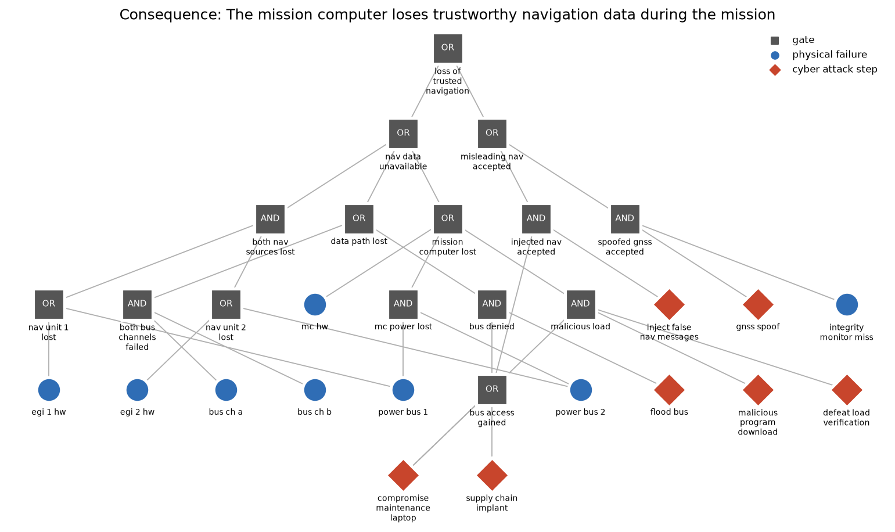
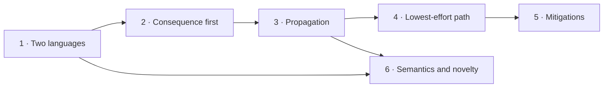

# One graph for failure and attack: the course

Six lessons that build, validate and use a single model for how a cyber-physical system can
lose a critical function, by random failure or by deliberate attack. They start with the two
classical diagrams engineers and security analysts already draw, unify them, and end with the
formal semantics and an honest look at what is new. Each lesson derives the method, walks
through the code in this repository, checks it against closed forms or independent
implementations, applies it to the same synthetic case study, and ends with exercises (answers
included).

## Lessons

| # | Lesson | You will learn | Key result |
|---|---|---|---|
| 1 | [Two languages for one failure](01-two-languages-for-one-failure.md) | structure functions, RBDs, attack trees, De Morgan duality, why the model is a DAG | any RBD converts exactly into failure logic, checked in every state |
| 2 | [Start from the consequence](02-start-from-the-consequence.md) | the four CCE phases, consequence statements, top-down development, an honest likelihood scale | a 15-gate case study covering availability and integrity, with 6 mixed branches |
| 3 | [Propagating probability and likelihood](03-propagating-probability-and-likelihood.md) | independence formulas, the common-cause trap, Shannon decomposition, Monte Carlo with Wilson intervals | separate physical and cyber analyses see only 69 % of the risk |
| 4 | [The lowest-effort path](04-the-lowest-effort-path.md) | minimal cut sets, three meanings of "lowest effort", importance measures, engineering out | removing the spoof cuts risk most; removing the laptop raises the cheapest attack from 5 to 42 weeks |
| 5 | [Comparing mitigations in one currency](05-comparing-mitigations.md) | mitigations as model changes, the beta factor, portfolio Pareto fronts, sensitivity and uncertainty | the best portfolio for risk and for attacker effort differ at every budget above 100 |
| 6 | [Formal semantics, and what is new](06-formal-semantics-and-what-is-new.md) | semantics, conservative extension, the interaction gap, limits of a static model, positioning against related work | both classical models are recovered exactly; 31 % of the case study's risk falls between them |

The lessons are meant to be read in order. Lesson 6 can be read after Lesson 3 by anyone
mainly interested in the formal side.

## Prerequisites

* Probability: independence, conditional probability, the law of total probability.
* Boolean algebra: AND, OR, De Morgan's laws.
* Python, to run the code and notebooks. No security background is needed: every attack step
  is described only by its effect on the system ([scope](../scope.md)).

## How to use the material

* Each lesson links its code, tests and results. The numbers in the lessons come from
  [`validation/results/`](../../validation/results/), which `validation/run_all.py`
  regenerates.
* Each lesson has a notebook in [`notebooks/`](../../notebooks/) that reruns its key steps.
* The reference notes in [`docs/`](../) (one per module, plus
  [`formal-semantics.md`](../formal-semantics.md), [`methodology.md`](../methodology.md) and
  [`related-work.md`](../related-work.md)) are shorter and denser than the lessons.
